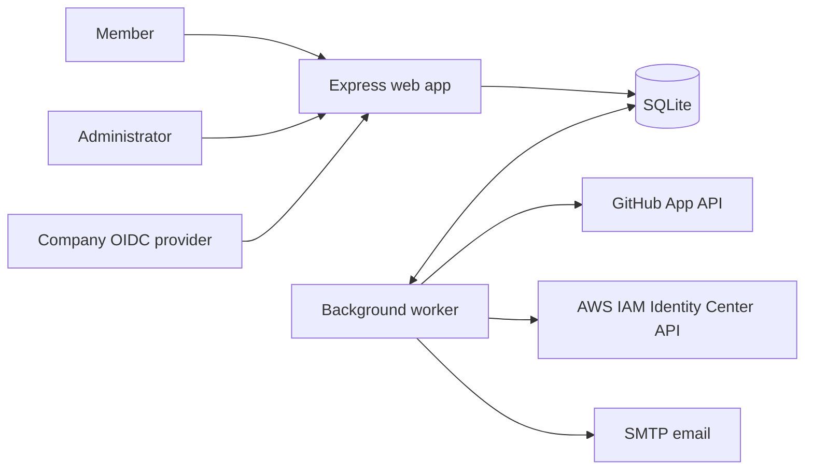
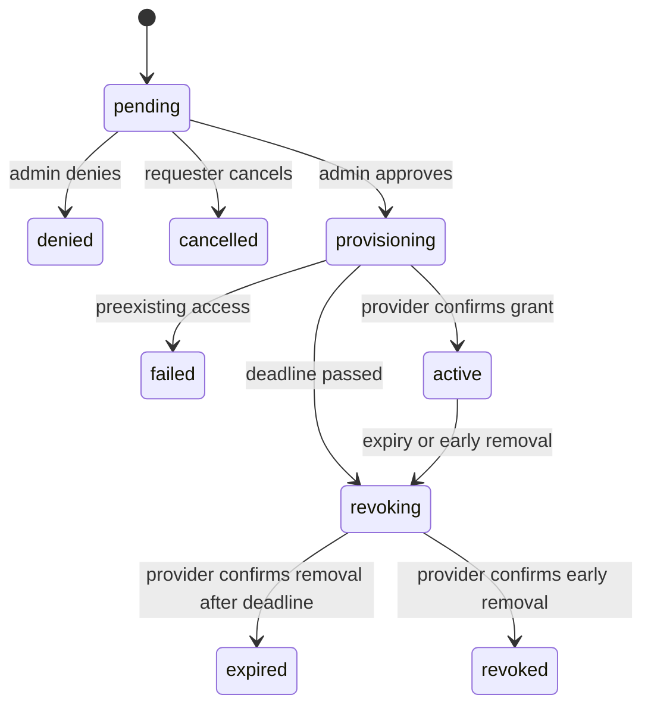

# Architecture

The product has two Node.js processes and one SQLite database. There is no frontend build or separate SPA API to understand.



## Find your way around

| Path | Responsibility |
| --- | --- |
| `src/server.js`, `src/app.js` | HTTP process, routes, authorization, CSRF, rendering |
| `src/auth.js` | OIDC code flow with PKCE/state/nonce; Floci Cognito locally |
| `src/access.js` | Request validation and transactional review/cancellation |
| `src/database.js` | SQLite schema, transactions, persistent sessions and outbox |
| `src/engine.js`, `src/worker.js` | Durable provider jobs, expiry, retries, email |
| `src/providers/` | GitHub and AWS adapters |
| `src/config.js` | Fail-closed Secrets Manager configuration and resource validation |
| `views/`, `public/` | Server-rendered pages and the small request-wizard script |
| `scripts/setup.js`, `scripts/doctor.js` | Interactive onboarding and diagnostics |
| `tests/` | Node test runner; fake provider and HTTP integration tests |

## Request lifecycle



The database stores the allowed resource, identity mapping and permission as a snapshot when the request is created. The server validates all choices against the operator catalog. A partial unique index prevents two open requests for the same user/resource. Review decisions and their audit/outbox entries commit together.

The worker checks every five seconds. It claims jobs with an expiring lease, records ownership intent and the expiry before the first provider mutation, and saves asynchronous AWS operation IDs between polls. Operations do not sleep while AWS works. Up to five independent jobs run concurrently; failed operations back off to a maximum of five minutes. Revocations get priority. A crash after a remote side effect but before a local commit can cause a retry: provider operations must be reconciled/idempotent. This is not a distributed transaction or exactly-once system.

Leases reduce accidental overlapping execution; they are not an HA guarantee for arbitrarily long API pagination or partitions. The supported deployment is one worker on one host. Dedicated managed grants must not have competing permission writers. See SECURITY.md for ownership and expiry limitations.

Email is delivered from a transactional outbox with retries and delivery leases. Delivery is at least once; a crash after SMTP acceptance can duplicate a notification. SES delivery uses the AWS SDK and Floci locally; no automatic-success sender is shipped.

## Add a provider

Implement an adapter with:

```js
class Provider {
  async preflight(request) {
    // Verify the grant is safe to manage. Throw AccessConflict for existing access.
  }
  async step(action, request) {
    // action is 'grant' or 'revoke'. Reconcile retries without extending expiry.
    // Resume request.operation_json if an async operation is already in flight.
    return { done: false, operation: { action, id: 'provider-operation-id' } };
    // Return { done: true, operation: null } only after provider confirmation.
  }
}
```

Register it in `src/providers/index.js` and extend config validation and the request tool chooser. Test existing access, unknown/failed operations, retry, revocation, expired provisioning, and crash recovery before exposing it. Do not put user-controlled URLs or identity mappings in provider calls.

## Persistence and upgrades

`schema_versions` records the initial schema version. This is the first Node.js schema, not a migration framework for the Python prototype. Future releases must add explicit, tested migrations. Database metadata binds a file to local or production infrastructure so local records cannot be silently processed against production providers. Keep these environments and volumes separate.

Sessions are opaque signed cookies backed by SQLite, have an eight-hour lifetime, and are regenerated on sign-in. Live cookies are Secure, HttpOnly, and SameSite=Lax. OIDC tokens remain server-side and are not stored as user credentials. Admin status is checked against the current runtime configuration on each request. Configuration changes require process restarts.

## Secrets and local infrastructure

`src/aws-runtime.js` validates the environment and confines local endpoints to Floci. `src/secrets.js` retrieves the AWSCURRENT application bundle, validates required secrets and whitelists credential fields. `loadConfig` is asynchronous and blocks activation until the bundle and metadata are valid. The web process can serve an unauthenticated setup-required 503 page while activation is blocked; it cannot sign in users or mutate providers. Local OIDC validates signed Cognito tokens through the same openid-client flow, routing server-side requests to the internal Floci endpoint when containerized. `scripts/provision-local.js` creates operator-supplied Cognito/Identity Center identities, a permission set and the server secret bundle using real SDK requests.
